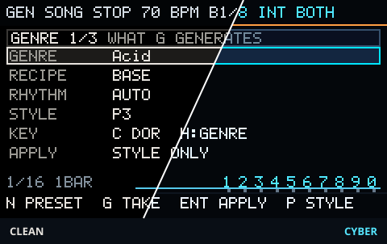
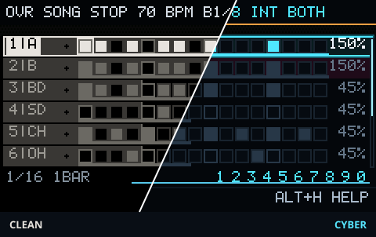
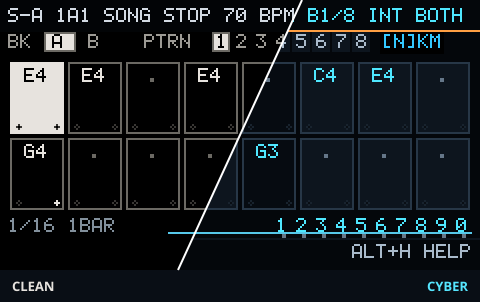
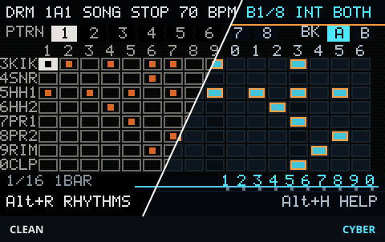
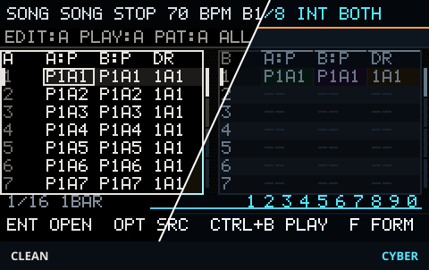
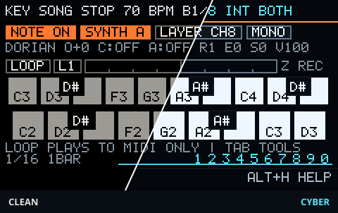
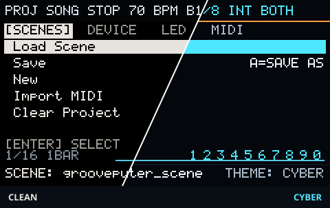

# GroovePuter 0.9.22 (unreleased) Manual

This manual describes the current user-facing GroovePuter workflow on the **0.9.22 (unreleased)** development source. The last tagged and packaged release is **v0.9.20**. **v0.9.16 — Foundation Freeze** is the earlier hardware-accepted foundation; see the release notes of the tagged release for its exact binary and acceptance boundary.

If this is your first session, do **not** start by reading the whole manual. Use [`docs/user/QUICKSTART.md`](docs/user/QUICKSTART.md) first. Its first-session vocabulary is deliberately small: `Space`, `Fn+M`, `G`, `D`, `Ctrl+Z` and `Alt+H`.

For the exact key-by-key reference use [`src/ui/docs/keys.md`](src/ui/docs/keys.md). For the bounded generated musical-play implementation and its research evidence see [`docs/0.9.14/P0_MUSICAL_PLAY_SPEC.md`](docs/0.9.14/P0_MUSICAL_PLAY_SPEC.md).

## 1. Workflow map

```text
PERFORM:  MIDI KEYBOARD -> MIDI PLAYER
GENERATE: GENRE -> FEEL
HUB:      OVERVIEW -> SYNTH A -> SYNTH B -> DRUMS
SONG:     SONG -> MATERIAL -> MATERIAL BANK
SETTINGS: PROJECT / SETUP
```

The main navigation model is:

- `Fn+M`: workspace launcher;
- `Fn+Tab`: next workflow;
- `[` / `]`: previous / next page inside the current workflow;
- `Fn+[` / `Fn+]`: previous / next workflow;
- `Alt+H`: page-aware on-device help;
- `Alt+V`: GENRE;
- `Alt+P`: MIDI Player;
- `Alt+X`: LiveMix;
- `Alt+M`: Song mode;
- `Alt+\`: switch between the `CLEAN` and `CYBER` themes.

`Alt+V` opens GENRE directly. `Fn+M -> GENRE` is the discoverable launcher path to the same page.

### Screens and themes

GroovePuter has two visual themes: **CLEAN** uses light text on black, while
**CYBER** adds color to highlights and controls. Switch between them with
`Alt+\`, or select **Theme** in PROJECT → DEVICE. The diagonal previews below
show CLEAN on the left and CYBER on the right; each full-size link shows the
complete screen in that theme. Captures are from the 0.9.21 development SDL UI.

| Screen | CLEAN / CYBER | Complete screen |
|:---|:---|:---|
| GENRE |  | [CLEAN](docs/screenshots/themes/genre-clean.png) · [CYBER](docs/screenshots/themes/genre-cyber.png) |
| OVERVIEW |  | [CLEAN](docs/screenshots/themes/overview-clean.png) · [CYBER](docs/screenshots/themes/overview-cyber.png) |
| SYNTH |  | [CLEAN](docs/screenshots/themes/synth-clean.png) · [CYBER](docs/screenshots/themes/synth-cyber.png) |
| DRUMS |  | [CLEAN](docs/screenshots/themes/drums-clean.png) · [CYBER](docs/screenshots/themes/drums-cyber.png) |
| SONG |  | [CLEAN](docs/screenshots/themes/song-clean.png) · [CYBER](docs/screenshots/themes/song-cyber.png) |
| PERFORM |  | [CLEAN](docs/screenshots/themes/perform-clean.png) · [CYBER](docs/screenshots/themes/perform-cyber.png) |
| PROJECT |  | [CLEAN](docs/screenshots/themes/project-clean.png) · [CYBER](docs/screenshots/themes/project-cyber.png) |

Hard-global Alt shortcuts run before page-local input. That is why a page must not document a local action on a chord already owned globally.

### Compatibility page IDs

The following persisted values remain decode/navigation aliases:

```text
GENERATION -> FEEL
TEXTURE    -> FEEL
Synth A SOUND -> SYNTH A
Synth B SOUND -> SYNTH B
```

There is no active standalone GENERATION, TEXTURE or SOUND workflow page. Synth sound editing lives in each Synth page's local `NOTES -> KNOBS -> MORE` tabs.

## 2. First-session key constitution

```text
Space     PLAY / STOP
Fn+M      choose GENRE / MATERIAL / other workspace
G         generate the thing on screen
D         DEVELOP on MATERIAL
Ctrl+Z    undo the last retained edit
Alt+H     help for this page
```

These are musician-facing rules, not a claim that every key is globally identical.

### `G` — Generate the thing you are looking at

- GENRE: generate the full musical material;
- Synth A/B: generate that selected Synth lane when NOTE ENTRY is off;
- DRUMS: generate drums;
- SONG: generate/assign material in the selected Song context;
- MATERIAL: create a TAKE at the displayed destination.

### `D` — contextual, not global

In the First Five Minutes workflow, `D` means **DEVELOP** only on MATERIAL.

Elsewhere it has page-local expert meanings. MATERIAL BANK, for example, uses `D` for derive. Do not infer a global `D = develop` rule from the beginner path.

## 3. GENRE, GEN and FEEL

The ownership rule is:

```text
GENRE != FEEL != GENERATION REQUEST != SOUND
```

### GENRE 1/3

GENRE owns the musical corridor, Variant/recipe, Rhythm identity and Apply policy.

Main controls:

- `Tab` / `Up/Down`: select the visible field;
- `Left/Right`: change the selected Genre/Variant/Rhythm/Apply field;
- `G`: full Stage 15 generation;
- `P`: `P1 -> P2 -> P3` (see "P1 / P2 / P3" below);
- `M`: cycle `PROFILE`, `MATERIALIZE`, `MATERIALIZE+BPM`;
- `Enter`: apply the selected policy.

While stopped, accepted generation commits immediately. During PLAY the full Synth A + Synth B + Drums result publishes at the next real `BAR_START` instead of replacing the sounding bar mid-cycle.

Repeated accepted `G` requests reroll the same selected musical direction through the bounded session attempt stream.

On supported GENRE/scale combinations, the `HARMONY` row can select `GRAPH` for the next generated Take. `LEGACY` keeps the existing progression source. If the current genre, scale, or home chord cannot be represented by the bounded materializer, the row shows `LEGACY / N/A:...`; graph generation is not available for that setup. This setting affects newly generated material. It does not reinterpret notes in a Take that is already playing.

`GRAPH` builds harmony from the selected genre policy, a deterministic song variation, the current harmonic state, and legal neighbors. The generated harmonic events are saved with their exact Synth A/B participant identities so later Song operations can keep the same meaning. `BREAK` may still be conservative for styles such as Acid, Jungle, and DnB. A bounded route that cannot satisfy the request is rejected with its source material preserved.

The development host package includes deterministic event traces for all 17 harmonic profiles. Eight profiles are host-only today; nine map to existing device genre settings. These traces are evidence for inspection, not rendered audio or a substitute for listening on the Cardputer.

### GEN 2/3

GEN is the optional local generation-target panel inside GENRE. `Tab` from GENRE opens GEN; `Tab` again requests FEEL; `Esc` returns to GENRE.

Its musician-facing choices are:

- `TARGET`: `STEPS`, `MELODY A` or `MELODY B`;
- `DRUMS`: `NEW` or `KEEP`;
- `LENGTH`: `1/2/4/8` bars for generated Melody/TAKE material;
- `LIVELY`: calm/normal/lively activity intent;
- `NOTES`: short/mixed/long note-length intent.

The First Five Minutes path does not require visiting GEN: its defaults are enough for an initial full generation. Use GEN when you want to decide what kind of material the next generation should write, rather than changing the Genre itself.

### FEEL 3/3

FEEL owns timing and velocity only:

- timing profile;
- swing;
- bounded FEEL amount;
- velocity variation;
- repeat cycle `1/2/4/8`;
- FEEL presets;
- the shared request level.

FEEL does not select notes, harmony, synth TYPE or timbre.

### P1 / P2 / P3

`P` cycles the request level used by the next `G`. The same three levels are used on every page:

- `P1`: faithful to the classic; keeps to the genre canon and the recipe.
- `P2`: variation; a recognisable pattern with limited changes.
- `P3`: rework; transforms the material more freely. It is the default since 0.9.17, and it is the only level on which the MATERIAL command `D` can develop a phrase. If the phrase is on `P2` and `D` is pressed, the toast reads `P: SET P3, THEN G`.

(Internally the levels are named CANON / VAR / TRANS; the names are not shown to the musician.)

## 4. SYNTH A / SYNTH B

Current selectable engines include:

- `TB303`;
- `SID`;
- `AY`;
- `SH101`;
- `SN76489`;
- `WAVEMORPH`.

Each Synth page uses:

```text
NOTES -> KNOBS -> MORE
```

with `Tab` cycling the local tabs.

### NOTES

Important controls:

- `Q..I`: pattern slot `1..8` outside NOTE ENTRY;
- `B`: bank A/B;
- `Alt+[` / `Alt+]`: pattern page;
- arrows: step cursor;
- `N`: NOTE ENTRY on/off;
- `C`: repeat the last entered pitch at the current step while in NOTE ENTRY;
- `F`: audible step retrigger on/off;
- `Alt+Up/Down`: retrigger count;
- `G`: selected-Synth Genre/recipe/STYLE/harmony generation when NOTE ENTRY is off;
- `P`: `P1 / P2 / P3` for the next selected-Synth `G`;
- `Alt+G`: legacy selected-Synth generation without the shared STYLE request;
- `Ctrl+C/V`: Copy / Paste.

Inside NOTE ENTRY, pitch keys retain their note-input meaning. A repeated/held pitch may continue into the next step as a `TI` continuation rather than a new attack.

NOTE ENTRY rows: `A..L` is the lower octave, `Q..P` the one above; `-`/`=` move them through octaves 1-2 .. 5-6 (default 3-4). A step holds C1..C7 (24..96): `S`/`X` and `A`/`Z` stop at C7. MIDI out sends the note as written (C#5 = 73: `=` once, then `W`; E5 = 76: `=` once, then `T`); the internal synth plays notes above B4 one or more octaves lower, same pitch class.

### Pattern and Melody source

A Pattern address is:

```text
PAGE x BANK x SLOT
```

for example `2B7`.

`Alt+R` switches a Synth slot between STEPS and MELODY source. If no accepted Melody exists yet, the conversion path creates one from the Pattern steps first. A Song row later resolves the slot's saved material descriptor; it does not need a second Pattern/Melody type flag in the row itself.

### Working material: ACCEPT / DISCARD / NEXT

- `D`: prepare the current local REVOICE development action where the Synth page owns it;
- `Enter` with NEXT ready: request GO; during PLAY activation waits for the next bar;
- `Esc`: cancel NEXT, or disarm a queued GO while keeping NEXT;
- `Alt+Enter` / `Ctrl+Enter`: ACCEPT working material;
- `Alt+Backspace`: DISCARD working edits to the accepted version;
- `Ctrl+Z`: bounded retained Undo where supported.

Current hard-global ownership means:

- `Alt+V` is **not** a reachable Synth CONNECT shortcut because the display owns it as the global GENRE navigation chord before the page sees the event;
- `Alt+X` is **not** a reachable Synth DISCARD shortcut because it is hard-global LiveMix.

The CONNECT operation may exist internally, but the current front-panel reference must not invent a key that cannot reach it.

### STEP SETTINGS (SYNTH)

`Alt+E` on STEPS opens a small window for the cursor step (all selected steps when an area is selected). `Up/Down` picks the field, `Left/Right` or `-`/`=` changes it:

- `PROB` 0..100 in steps of 5;
- `TIMING` -23..23 ticks (minus is earlier, plus is later);
- `VEL` 1..127 in steps of 5;
- `CHANCE` 100% or 80%: at 80% the note sounds with 80% probability, multiplied by `PROB` (the final chance is CHANCE x PROB). With `PROB` below 100 a line such as `80% =64%` shows the result: `PROB` 80 and `CHANCE` 80% give `80% =64%`. It is not a quiet note (this was called GHOST before).

`Backspace` resets the selected field to its default; `Ctrl+Backspace` resets all fields of the step (or of the selection). `Enter` or `Esc` closes; `Opt` is ignored while the window is open. The window hint reads `UP/DN FIELD  L/R VALUE  ENT/ESC CLOSE`; the footer shows `UP/DN:FIELD L/R:VALUE` and `ENT/ESC:CLOSE`. Every key press is one Undo step, and `Ctrl+Z` takes back only the last press. A step with a non-default TIMING shows a small square in the top corner of its cell: left corner for early, right corner for late. A note cell with a 2x2 dot is a step whose `PROB`, `VEL` or `CHANCE` differs from the default. Clearing: `Ctrl+Backspace` on STEPS clears the whole pattern as one Undo step (toast `PATTERN CLEARED  CTRL+Z UNDO`); with a selection only the selection is erased (toast `SELECTION CLEARED`). `Alt+O` cycles the synth output mode (toast `SYNTH A OUT:`).

### KNOBS / MORE

These tabs own Synth TYPE, engine parameters and supported FX/sound editing. They are not separate workflow pages.

## 5. DRUMS

`Tab` cycles the DRUMS sub-pages: GRID / SOUND / AUTO. SOUND (formerly "GLOBAL SETTINGS", now titled "DRUM SOUND"; SOUND means the timbre) is where the drum engine and drum effects are changed. (A SAMPLES sub-page exists only in the SDL emulator, not on the Cardputer.)

The main generation controls are intentionally distinct:

```text
G             generation: strong regeneration, RHYTHM + FEEL in one Undo step
Ctrl+G        randomize focused drum voice
Alt+G         full-pattern CHAOS (in the RHYTHM BROWSER: previous group)
P             shared request level (P1 / P2 / P3)
Alt+O         cycle DRUMS output mode (toast DRUMS OUT:)
```

The grid uses `Q..I` for patterns, `B` for bank, arrows for the cursor, `Enter` for the selected hit and `A` for accent on an existing hit.

Clearing: `Backspace` erases the cell, or the selection when there is one. `Ctrl+Backspace` clears the WHOLE pattern of the slot as one Undo step and drops the selection, also when something is selected (toast `DRUMS CLEARED  CTRL+Z UNDO`; `DRUMS ALREADY CLEAR` when it is empty already; `DRUMS CLEAR FAILED` on failure). `Alt+Backspace` does not touch the pattern; it only shows `CTRL+BKSP CLEARS PATTERN`.

A note cell with a 2x2 dot is a step whose `PROB`, `VEL` or `FLAM/ROLL` differs from the default. TIMING has its own mark in the top corner.

### RHYTHM BROWSER

`Alt+R` or `Opt` on the grid opens the browser; `Opt` or `Esc` closes it. The position (rhythm, group, variant) is remembered between openings. `Up/Down` picks the rhythm, `Left/Right` the variant, `G` the next group and `Alt+G` the previous group (both wrap around; the current rhythm is kept if it is in the group; an empty group shows `EMPTY`). The bottom hint reads `UP/DN RHYTHM L/R VAR G/Alt+G GRP`. The info line shows `VAR n/m  N BPM`; before the audition it adds `TAB HEAR  G GROUP`, during it `1-0 MUTE  M SOLO`. There is no ATLAS/PRESET/VOCAB label in the browser. `Tab` or `Space` starts and stops the audition, which plays exactly the rhythm that APPLY would write. `1..0` mutes a voice and `M` solos one, both only while auditioning. The footer shows `ENTER APPLY` and `ESC CLOSE`. `Enter` is APPLY: it replaces all 8 voices of the pattern in the current slot (toast `ALL 8 VOICES -> A1 CTRL+Z`); `Ctrl+Z` takes it back.

### STEP SETTINGS (DRUMS)

`Alt+E` on the grid opens the window for the cursor cell (all selected cells with an area; the first cell of the area gives the value, and `MIXED` shows when the values in the area differ). Fields: `PROB` 0..100 in steps of 5; `TIMING` -23..23 ticks (minus earlier, plus later); `VEL` 1..127 in steps of 5; `FLAM/ROLL` OFF -> FLAM (a second hit 2 ticks later) -> ROLL (4 hits inside the step). A RETRIG, REVERSE or PITCH step effect is shown by name and is replaced by FLAM or ROLL. `Backspace` resets the selected field; `Ctrl+Backspace` resets all fields of the step (or of the selection). The window hint `L/R:SET  ENT/ESC:CLOSE` is unchanged. `Enter` or `Esc` closes; `Opt` is ignored while it is open. Each key press is one Undo step; `Ctrl+Z` takes back only the last press. A cell with TIMING other than 0 shows a small square in its top corner (left = earlier, right = later), visible only on a step that sounds.

## 6. SONG

Song rows refer to pattern/material slots. For Synth A/B, the saved slot descriptor decides whether playback uses Pattern or Melody.

Important controls include:

- `Up/Down`: Song row;
- `Left/Right`: move across Synth A -> Synth B -> Drums;
- `Q..I`: assign an existing slot;
- `G`: generate safe material and assign the selected cell;
- double `G`: materialize Synth A + Synth B + Drums for the current row;
- `Opt` on a Synth A/B cell: toggle that voice's source STEPS <-> MELODY;
- `Backspace`: clear the current/selected Song cell;
- `Ctrl+N` / `Ctrl+M`: insert / remove row;
- `Alt+J`: open MATERIAL with the row as an explicit destination;
- `F`: open FORM;
- `Alt+X`: global LiveMix, not a Song-local discard command.

A working Melody can keep sounding while being edited. ACCEPT/DISCARD belongs to the material/Synth ownership path; do not rely on the obsolete `Alt+X = DISCARD` wording from older documentation.

### FORM

FORM builds ordinary Song rows from existing material using an energy curve. Press `F` on SONG to open it.

- `Left/Right`: choose section;
- `Up/Down`: energy `0..4`;
- `Enter`: section length `4/8` bars;
- `N`: add a section;
- `Backspace`: delete a section;
- `1/2/3`: BUILD / DROP / WAVE curve;
- `G`: insert generated form rows after the source block (selection, otherwise the TAKE at the cursor);
- `F` / `Esc`: back to the normal Song grid.

Energy is structural rather than a timbre macro: `0` is silence, `1` drums, `2` drums+bass, `3` adds the lead with a recurring rest, and `4` uses the full available arrangement including Voice. The inserted rows remain normal editable Song rows; one `Ctrl+Z` undoes the FORM insertion.

## 7. MATERIAL — the first-session composition page

MATERIAL exposes the generated-Phrase product workflow through:

```text
LENGTH
STYLE
TO
LAST ACCEPTED
```

The beginner model is:

```text
G  -> NEW TAKE
D  -> DEVELOP eligible fresh TAKE
R  -> MAKE ROOM when slots are exhausted
```

### First bounded development cycle

1. `Fn+M` -> MATERIAL.
2. Set `LENGTH 4B`.
3. Set `STYLE P3`.
4. Leave `TO APPEND` for the simplest workflow.
5. Press `G` for a fresh TAKE.
6. While that TAKE remains unedited and in the same source context, press `D`.
7. Listen through the resulting `DEVELOP + BREAK` or `BREAK ONLY` section.
8. `Ctrl+Z` removes the retained added cycle if you do not want it.

The current implementation intentionally supports a bounded first slice. It is better for the UI to say “make a fresh 4B P3 TAKE first” than to expose semantic/depth implementation vocabulary.

Acid and House do not grow in the current bounded development path. Edited-source growth, repeated multi-cycle development and persistent development history also remain outside this slice unless a later version explicitly closes them.

### Make room

When `G` or `D` says `NO ROOM`, press plain `R`.

The automatic offer is limited to generated takes from the current session that:

- are no longer used by Song;
- have not been hand-edited;
- are not CURRENT/working/NEXT/Undo-protected material.

`Enter` allows those slots to be reused later; `Esc` cancels; `S` opens the expert slot-by-slot chooser. Granting permission does not erase material immediately.

## 8. MATERIAL BANK

MATERIAL BANK is the older capture/derive/write workspace and remains a separate expert page.

```text
1..4              Phrase A/B/C/D
Up/Down           1/2/4/8-bar length
Left/Right        preview saved Phrase bar
Ctrl+Left/Right   TO +/-1
Ctrl+Up/Down      TO +/-8
Enter             capture current Song region
D                 derive parent into selected slot
G                 generate connected material at TO
W                 INSERT before TO
Alt+W             REPLACE at TO
```

Clearing the whole Song is `Ctrl+Backspace`; `Alt+Backspace` on SONG only shows the hint `CTRL+BKSP CLEARS SONG`.

Fresh multi-row Phrase generation is STOP-only. Here `D` means derive, not the MATERIAL DEVELOP action.

## 9. PERFORM and external keyboard

PERFORM is a standalone live instrument: Cardputer keys work without a connected MIDI keyboard. `Tab` opens its tools; `Tab` and `Backspace` move between KEY / CHORD / ARP / RHYTHM / INPUT / LOOP. The selected row is edited with arrows and activated with `Enter` where the row offers an action.

KEY sets the live note range, scale, velocity and target. CHORD configures voicing and chord memory. ARP configures its pitch source (held notes, chord memory, current harmony or role), order, octave range, latch and behavior when harmony changes. RHYTHM configures the shared clock, gate, ratchet, Euclidean rhythm and chord strum. A row marked `N/A` is not active in the current configuration; the hint line explains the requirement.

LOOP is the looper on one screen, six rows and no scroll: `LOOPER`, `REC`, `LOOP BARS`, `LAYER`, `MUTE LAYER`, `TO MELODY` (always visible). INPUT is one scrollable list (a scroll bar appears on the right when it is longer than the screen) with three groups, from top to bottom; the headings are not selectable:

- `--- MIDI IN ---`: `MIDI IN`, `LISTEN CH`, `SEND TO`, `PLAY AS`, `LEAD STYLE`. RAW plays incoming pitches unchanged; BASS, LEAD and CHORD interpret new notes using the current performance context. These choices transform newly played live notes; they do not rewrite a Pattern or an already-playing Song.
- `--- LOOP SETUP ---`: `LOOP CH`, `NOTE LENGTH`, `HOLD LAYER` (the rest of the looper is on the LOOP tab).
- `--- HELPER ---`: `HELPER`, `REPLY BARS`, `REPLY CH`, `FREEZE RIFF`, `VARIATION`, `NEW RIFF IF`.

### LOOPER

`REC` chooses KEYS (pressed notes before Smart Play) or SOUND (live generated notes, including chords and arp). Select it before arming: it is locked during ARM, REC and DUB. Both modes store note starts and ends on a grid of 1/6 of a sixteenth (a 1/96 note, about 20 ms at 120 BPM); a recorded note lasts at least one such tick. SOUND therefore keeps arp rates 1/16T, 1/32 and 1/8T and the arp gate as played, and KEYS keeps the timing of the hands instead of pulling it to 1/16. Swing or strum offsets finer than one tick are not preserved, and two attacks of one pitch inside one tick are one note. `TO MELODY` still rounds every note to the 1/16 grid of the Melody (length at least one step), so a triplet or 1/32 line loses its rhythm there. The 192-event pool is shared by both layers and undo; an eight-bar 1/16 arp leaves room for 64 further events, after which new notes are dropped with a FULL notice. An eight-bar 1/16T arp is exactly 192 notes and fills the pool; a 1/32 arp fills it in six bars.
Playback can schedule up to 32 simultaneous notes per plan; denser same-step chords may lose notes. TO MELODY refuses exports with more than 128 events.

A MIDI looper on the live surface: `Z` records and dubs, `C` plays and stops, `V` undoes the last pass, `B` holds the active layer, `M` switches between layer 1 and 2, `Del` clears the active layer, `X` is panic (the loop stops, its notes are kept). `Ctrl+Z` goes to the looper while it has something to undo. `LOOP CH` is `DX ROUTE` by default (the loop plays on the channel and target of PERFORM DX; hint `DX ROUTE: SAME CH AS PERFORM DX`) or `CH1..CH16`; `REPLY CH` has the same `DX ROUTE` value. The counter `N/192` is brighter when `V` has something to undo, and an empty loop in IDLE shows `Z REC`. Looper toasts start with `LOOP:`: `LOOP: EMPTY, Z TO REC`, `LOOP: NO ROOM TO REPEAT`, `LOOP: FULL, NOTES DROPPED`, `LOOP: STOPPED, HELPER ON`, `LOOP: HELPER OFF FIRST`. The loop sounds only over MIDI, there is no internal sound; the first `Z` on the internal output shows a one-time toast `LOOP: DX ROUTE, NO INTERNAL SOUND`. When the keyboard target is DRUMS, `Z` refuses with `LOOP: N/A FOR DRUMS`.

`HOLD` (`B` or the `HOLD LAYER` row) keeps the active layer as it is: REC, UNDO and CLEAR are refused with `LOOP: HOLD, B TO RELEASE`. The chip `HOLD` is shown, the toast reads `LOOP: L1 HOLD ON/OFF` and the footer `[B]HOLD OFF`. It is not the same as ARP HOLD or CHORD HOLD.

### HELPER

The HELPER group replies over MIDI to what you play (`HELPER` OFF/ANSWER/DUET/RIFF; it was called PARTNER). The helper and the loop share one player and never play together: while `HELPER` is not OFF the LOOPER does not work, the `LOOPER` row shows `HELPER ON`, and `Z`/`C` show `LOOP: HELPER OFF FIRST`. Turn it off at INPUT > HELPER > OFF.

### TO MELODY

The last row of the LOOPER group. `Left/Right` picks synth A or B (default: GEN TARGET). The first `Enter` asks `REPLACE MELODY A WITH LOOP? ENTER`; a second `Enter` within 4 seconds replaces the Working Melody with the unmuted layers. Changing the synth, the number of bars or the MUTE mask cancels the confirmation. If that synth has an unsaved Working Melody the toast is `SAVE OR DISCARD A FIRST` and nothing is exported. On success: `MELODY A <- LOOP  CTRL+Z ON SYNTH A`; undo with `Ctrl+Z` on the synth page (NOTES tab). A third `Enter` does not open the synth page. Nothing is saved automatically; save with `Alt+Enter` on the synth page.

With MIDI input enabled and routed to PERFORM, CC80 controls ARP and CC81 controls LATCH: values 64–127 mean ON and 0–63 mean OFF. These are absolute commands, so a repeated ON value stays ON. LATCH ON is ignored while ARP is OFF. Other CCs remain unbound unless another explicit mapping is configured.

The PROJECT MIDI setup chooses the USB boot role (`COMPUTER`, `KEYBOARD`, or `OFF`), applied across the explicit reboot boundary. A connected keyboard adds physical keys and its supported velocity/controls; it is not required for the Cardputer performance workflow. KEY, CHORD, ARP and RHYTHM configuration is saved after a short quiet period and restored at startup. LOOPER and HELPER settings (and the recorded loop) are not saved between sessions; they last for the session only.

### Words on the screen

- `FEEL`: timing and strength of the hit (the FEEL page 3/3, and part G on DRUMS).
- `SOUND`: the timbre (the DRUMS tab "DRUM SOUND", SOUND on the synths).
- `HOLD`: holding a looper layer (`B`); not the same as ARP HOLD or CHORD HOLD.
- `HELPER`: the partner (reply, duet, RIFF; the old LOOP mode is now called RIFF).
- `DX ROUTE`: the loop plays on the channel and target of PERFORM DX.
- `P1`/`P2`/`P3`: the levels of the generation style.

## 10. MIDI Player and HUB MIDI

Open MIDI Player with `Alt+P`.

Core controls include:

- `Space`: MIDI transport;
- `1..9`: physical-track mute;
- `U`: physical mute mixer;
- `I`: channel inspector;
- `S`: structural inspector / mark loop A in loop context;
- `E`: mark loop B;
- `D`: performance/throughput panel;
- `H`: Player <-> HUB MIDI;
- `M`: RAW / SEQTRAK routing mode;
- `C`: clock source;
- `T`: tempo mode;
- `L`: loop `OFF -> SONG -> A-B -> OFF`;
- `R`: restart file;
- `X`: SMF-owned note cleanup/panic.

A-B loop marks are bar-based. Without explicit marks, A-B starts as a four-bar loop from the playhead. A new file clears the marks.

### HUB MIDI

With a loaded MIDI session:

- `Up/Down`: select projected physical layer;
- plain `Left/Right`: change route immediately (`AUTO`, `CH1..CH10`), including during PLAY;
- `Fn+Left/Right`: physical-track level;
- `Enter` or `1..9`: mute/unmute;
- `S`: solo;
- `L`: cycle the player loop mode; `A` marks its start and `E` marks its end;
- `0`: all MIDI tracks on;
- `O`: show which tracks occupy the SEQTRAK outputs;
- `Y`, then `Y`: GRAB the selected layer into a Working Melody while paused;
- `H`: return to Player.

GRAB uses the player's A-B loop when present; otherwise it takes the current GEN LENGTH window from the current bar. The GEN TARGET chooses Melody A or B. The first `Y` previews what will be taken and where; the second performs the grab. On the destination Synth page, `Ctrl+Z` undoes it.

Route changes invalidate stale queued events from the previous destination and perform scoped cleanup rather than forcing a global panic.

## 11. Save and Undo

Project Save/Load lives on PROJECT. It is distinct from Synth `Alt+Enter`, which ACCEPTs working material.

`Ctrl+Z` is the public global Undo chord for the current bounded retained edit. GroovePuter intentionally does not pretend to provide an unlimited DAW-style history. Undo is single-level: it takes back only the last press (for example one STEP SETTINGS change), not the whole series of presses.

After a meaningful first session, save and reload once to confirm that the project, material descriptors and Song references return together.

## 12. Help strategy

Use documentation in this order:

1. on-screen footer;
2. `Alt+H` page-aware help;
3. [`docs/user/QUICKSTART.md`](docs/user/QUICKSTART.md);
4. [`src/ui/docs/keys.md`](src/ui/docs/keys.md) for the complete key map;
5. this manual for workflow detail;
6. research/architecture documents only when investigating implementation or design history.

The goal is that a musician reaches a first useful result before needing levels 4-6. The GEN, FORM and GRAB controls stay optional until the musician asks for more control over target, form or captured MIDI material.

## 13. Build / install boundary

This candidate has no published binary or user-oriented installer yet. Developer builds use the repository scripts and CI; the release remains blocked on a reproducible install path that a new owner can follow without setting up the development toolchain. Do not treat an arbitrary development build as a released image.

The last tagged source baseline and latest packaged GitHub Release is `v0.9.20`; 0.9.21 is not yet released. The earlier hardware-accepted foundation is `v0.9.16`. Exact hashes, FQBN and hardware acceptance evidence belong to the matching release notes and `docs/releases/` records.

## 14. Product boundary

The first-user facade is an onboarding layer, not permission to reopen the musical architecture.

Do not add speculative lineage, genre or generation subsystems merely to improve onboarding. If first-user observation proves a specific musical or runtime gap, open the smallest evidence-backed follow-up.
